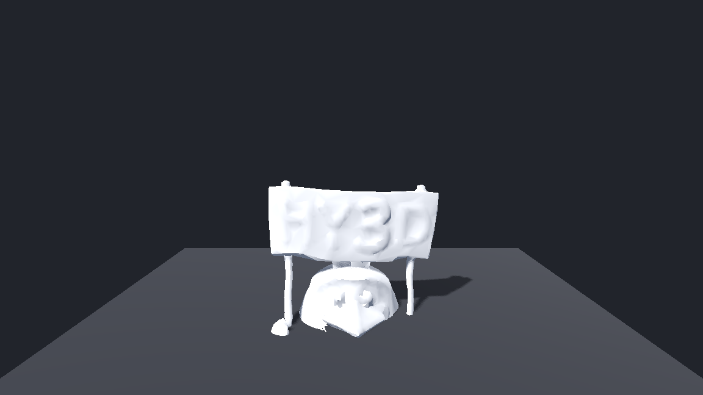
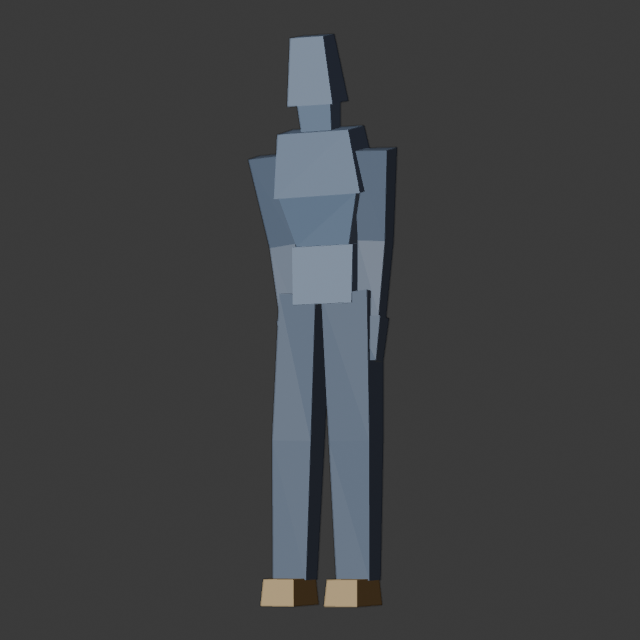
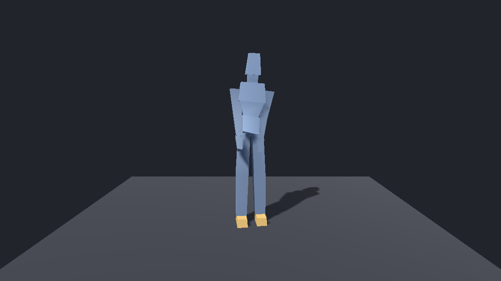
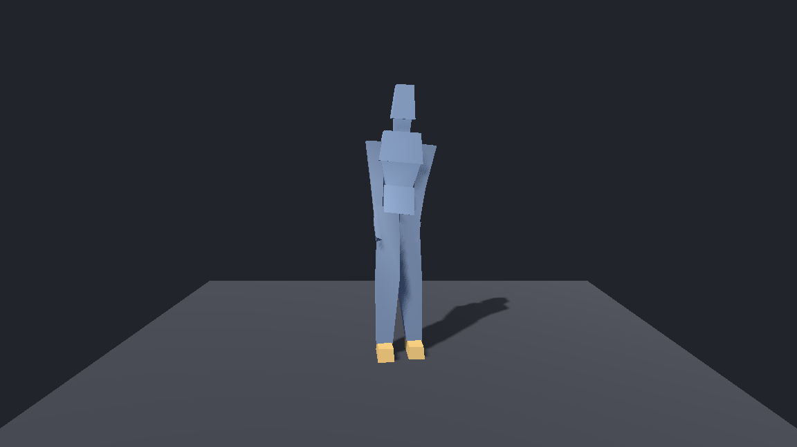

# GodotModelForge

**AI 生成 3D 模型 → 自动导入 Godot** 的落地工程。

这个项目解决的核心问题不是「怎么生成模型」，而是
**「生成出来的东西怎么可靠地变成 Godot 里能用的资产，并且能被自动验证」**。
生成端（程序化建模 / 图生3D / 文生3D）可以随便换，但落地标准和验证必须稳定。

---

## 当前状态

| 环节 | 状态 | 说明 |
|---|---|---|
| Godot 引擎接入 | ✅ 已完成 | Godot **4.7.2** stable，可无头读写项目、跑导入、跑自检 |
| 项目骨架 | ✅ 已完成 | 目录规范、`.tscn`/`.gd` 全部可被 DSH 直接读写 |
| 自动验证 | ✅ 已完成 | 脚本解析 + 资源导入 + 资产自检 三关，返回退出码 |
| 建模后端 | ✅ 已完成 | **Blender 5.2.2**（以 `bpy` Python 模块方式运行，无需安装 Blender） |
| 端到端链路 | ✅ 已跑通 | 程序化生成带骨骼动画的角色 → GLB → Godot 导入 → 自检全绿 |
| 自动绑定（auto-rig） | ✅ 已完成 | **任意静态网格 → 分析体型 → 套 19 骨骼人形骨架 → 蒙皮 → 套 4 段动画 → Godot 验证通过** |
| 重拓扑 + UV | ✅ 已完成 | **125 万面三角汤 → 8000 面流形网格 + UV → 绑定 → Godot 渲染通过** |
| AI 图生3D 生成 | ✅ 已跑通 | **Hunyuan3D-2mini，峰值显存 4.45/6.44 GB，单次约 67 秒**；官方参考图 → 生成 → 重拓扑 → 绑定 → Godot 渲染全链路通过 |

### 跑通的样子

**AI 图生3D 全链路**（官方参考图 → Hunyuan3D-2mini 生成 32 万面 → 重拓扑 9000 面 → 自动绑定 → Godot 渲染）：



Blender 侧模型（Workbench 渲染，带骨骼显示）：



Godot 侧真实渲染（Vulkan / Forward+，自动截图）：



自动绑定链路产出的资产（静态网格 → 自动套骨架，同样在 Godot 里渲染）：



---

## 环境（本机已装好）

| 组件 | 路径 | 说明 |
|---|---|---|
| Godot 4.7.2 | `D:\Tools\Godot\Godot_v4.7.2-stable_win64_console.exe` | 用 `_console.exe` 版本才能拿到控制台输出 |
| Blender 5.2.2 (bpy) | `D:\Tools\Python313-blender\python.exe` | 专用 Python 3.13 + `bpy` 模块 |
| 项目本体 | `D:\deepseek Flash\GodotModelForge` | 本目录 |

环境变量覆盖（可选）：

```powershell
$env:GODOT_BIN   = 'D:\path\to\godot_console.exe'   # verify.ps1 用
$env:BLENDER_PY  = 'D:\path\to\python.exe'          # 装了 bpy 的解释器
$env:BLENDER_BIN = 'D:\path\to\blender.exe'         # 有完整 Blender 时用这个
```

> ⚠️ 本机 PowerShell 执行策略禁止直接运行 `.ps1`。
> 请用 `tools\*.cmd`（内部已带 `-ExecutionPolicy Bypass`），
> 或手动 `powershell -ExecutionPolicy Bypass -File <脚本>`。

---

## 目录结构

```
GodotModelForge/
├── project.godot                 Godot 项目定义
├── icon.svg
├── assets/                       ← 生成产物落地处
│   ├── characters/<资产名>/       ← 一个角色一个目录
│   │   ├── <资产名>.glb           主资产
│   │   ├── <资产名>.meta.json     生成元数据（来源/骨骼/片段清单）
│   │   └── <资产名>.preview.png   预览图
│   ├── props/  environments/  textures/
│   └── references/               参考图与中间产物（.gdignore，Godot 不扫描）
├── scenes/Main.tscn              观察窗口 + 无头自检入口
├── scripts/
│   ├── Main.gd                   命令行参数解析 / 自检 / 展示
│   └── AssetInspector.gd         资产规范检查器（网格/骨骼/蒙皮/动画/材质）
├── tools/
│   ├── build.cmd                 一键：程序化生成角色 + 验证（+ 预览图 / 截图）
│   ├── rig.cmd                   一键：给任意静态网格自动套骨架加动画 + 验证
│   ├── verify.cmd                一键：验证
│   ├── verify.ps1                三关校验实现
│   ├── blender/
│   │   ├── rig_lib.py            ★ 共享库：骨骼规范 / 蒙皮权重算法 / 动画库 / GLB 导出
│   │   ├── mesh_ops.py           ★ 重拓扑：焊接 / 体素重网格 / 减面 / 展 UV
│   │   ├── gen_character.py      程序化建模（自带网格，走共享库绑定）
│   │   ├── auto_rig.py           ★ 自动绑定：分析体型 → 贴合骨架 → 蒙皮 → 加动画
│   │   ├── make_reference.py     渲染图生3D 用的参考图（Workbench studio 光）
│   │   └── render_preview.py     渲染预览图（Workbench，无需 GPU 光追）
│   ├── pipeline/
│   │   ├── build_character.ps1   程序化生成的入口
│   │   ├── rig_asset.ps1         自动绑定的入口
│   │   ├── strip_rig.py          剥离 GLB 的骨骼/动画（造测试样本）
│   │   ├── hunyuan3d_shape.py    ★ 本地图生3D（Hunyuan3D-2mini）
│   │   ├── dino_key_map.py       ★ DINO 权重适配（见下方「踩过的坑」）
│   │   ├── download_hunyuan3d.py 从 hf-mirror 下载权重
│   │   └── diagnose_dino.py      DINO 编码器数值健康诊断
│   ├── godot/
│   │   └── screenshot.gd         Godot 真实渲染截图（SceneTree 脚本，支持 --asset 指定角色）
│   └── _fixtures/                测试样本（已 gitignore，可重新生成）
└── docs/ASSET_SPEC.md            资产规范（命名/朝向/骨骼/预算/坑）
```

---

## 怎么用

### 给任意模型自动套骨架并加动画（核心能力）

图生3D / 文生3D / 网上下载的模型，通常只有**一个静态网格**：没骨骼、没蒙皮、没动画。
这个命令把它变成可直接进游戏的动画角色：

```cmd
tools\rig.cmd "D:\ai_out\monster.glb" -Preview -Screenshot
```

依次执行：分析体型（总高/髋宽/肩宽/手臂伸展/腿是否分开）→ 贴合 19 骨骼标准人形骨架
→ 计算蒙皮权重（带左右串扰惩罚）→ 套用 Idle/Walk/Run/Attack 四段动画
→ 导出 GLB → Godot 导入并自检 → 渲染预览图与场景截图。

**如果输入是 AI 生成的「三角汤」（高面数、无 UV、顶点重复），必须加重拓扑参数**：

```cmd
tools\rig.cmd "D:\ai_out\monster.glb" -Prepare -TargetFaces 8000 -Remesh voxel -Uv smart
```

实测效果：**125 万三角面 / 376 万顶点 / 无 UV → 8000 三角面 / 3962 顶点 / 带 UV**，
34.9 秒完成，Godot 自检全绿。

| 参数 | 作用 |
|---|---|
| `-Prepare` | 开重拓扑工序（焊接 → 清理 → 体素重网格 → 减面 → 法线 → 平滑 → 展 UV） |
| `-TargetFaces 8000` | 目标三角面数（游戏角色建议 5k–20k） |
| `-Remesh voxel\|quad\|none` | `voxel` 快且均匀；`quad` 拓扑更好但慢很多 |
| `-Uv smart\|keep\|none` | `smart` 自动展 UV；生成模型本来没 UV 时用这个 |
| `-StripRig` | 输入自带骨骼动画时先剥掉再重新绑定 |
| `-Name myasset` | 指定落地资产名（默认取输入文件名） |
| `-Height 2.4` | 缩放到目标身高（默认 0 = 保持原尺寸不缩放） |
| `-Clips Idle,Walk` | 只套指定动画；`-Clips none` = 只要骨骼不要动画 |
| `-SidePenalty 4` | 出现「左臂动右臂跟着动」时调大，抑制左右串扰 |
| `-NoVerify` | 跳过 Godot 验证（不推荐） |

### 剥离现成模型的骨骼/动画（造测试样本、清瘦资产）

```cmd
python tools\pipeline\strip_rig.py --in hero.glb --out hero_static.glb --report strip.json
```

只保留网格与材质，去掉骨架/蒙皮/动画。上面的自动绑定链路就是用它造出
「图生3D 风格」的输入来验证的（129 KB → 16.8 KB）。

### 本地 AI 图生3D（一张图 → 3D 模型）

```cmd
python tools\pipeline\hunyuan3d_shape.py --image 参考图.png --out mesh.glb --steps 30 --octree 256
```

本机 6 GB 显存下**唯一可行**的本地免费生成模型是 **Hunyuan3D-2mini**。实测数据：

| 项 | 实测值 |
|---|---|
| 峰值显存 | **4.45 GB / 6.44 GB** |
| 单次耗时 | **约 67 秒**（30 步，octree 256） |
| 输出 | 13 万–50 万三角面（原始，需重拓扑） |
| 权重体积 | 4.3 GB（自包含：conditioner + model + vae 在同一文件） |

**为什么不用更强的 TRELLIS.2**：实测其权重合计约 **7.9 GB**（int8 模型 4.89 GB +
VAE 1.02/0.88 GB + CLIP-ViT 1.13 GB），6 GB 显存装不下。Hunyuan3D-2mini 的
turbo 权重只有 3.56 GB + VAE 0.38 GB，是唯一装得下的。

**推荐用法（配合重拓扑与绑定）**：

```cmd
REM 一步到位：图 → 3D → 重拓扑 → 骨骼动画 → Godot 验证
python tools\pipeline\hunyuan3d_shape.py --image ref.png --out out.glb
tools\rig.cmd out.glb -Name mychar -Prepare -TargetFaces 9000 -Uv smart -Screenshot
```

⚠️ **参考图质量决定成败**（实测结论）：

| 输入图 | 生成结果 |
|---|---|
| 官方 demo.png（真实照片，有纹理有光照） | ✅ 正常三维体，跨度比 1.8 |
| 自渲灰模（无贴图，单色） | ❌ 退化成 2m×2m×0.34m 的平板，跨度比 5.8 |
| 带骨骼线框叠加的预览图 | ❌ 同样是平板 |

**图生3D 需要的是「有纹理、有自然光照的真实照片」**。用无贴图灰模测图生3D 本身
就是不合适的测试 —— 模型拿不到任何表面线索，只能吐出先验均值。
渲染参考图时用 `tools\blender\make_reference.py`（Workbench studio 光 + cavity，
保证有明暗），但即便如此，灰模仍不如真实带纹理的照片。

### 生成一个新角色并验证

```cmd
tools\build.cmd myhero -Force -Preview -Screenshot
```

依次执行：Blender 建模导出 GLB → 渲染 Blender 预览图 → **调 Godot 导入并自检**
→ 用 Godot 真实渲染截一张场景图。全绿才算成功。

只想要其中几步就去掉对应开关（`-Preview` / `-Screenshot`），验证是默认开启的。

### 只验证已有资产

```cmd
tools\verify.cmd res://assets/characters/hero/hero.glb 15 3
```

参数：资产路径、最少骨骼数、最少动画片段数。

### 只截 Godot 场景图

```cmd
D:\Tools\Godot\Godot_v4.7.2-stable_win64_console.exe --path . --script res://tools/godot/screenshot.gd -- --screenshot=docs/preview/hero.godot.png
```

注意：截图必须用**真实渲染驱动**，`--headless` 下拿不到画面。

### 在 Godot 里肉眼看

```cmd
D:\Tools\Godot\Godot_v4.7.2-stable_win64.exe --path "D:\deepseek Flash\GodotModelForge"
```

`Main.tscn` 会自动加载 `hero.glb`、播放第一个动画并让角色缓慢旋转。

### DSH/AI 自动化用的无头自检

```cmd
D:\Tools\Godot\Godot_v4.7.2-stable_win64_console.exe --headless --path . -- --check=res://assets/characters/hero/hero.glb --json --min-bones 15 --min-clips 3
```

输出一行 JSON，退出码 0=通过 / 1=失败，便于脚本判断。

---

## 为什么这样设计

1. **验证优先于生成。** 生成模型很容易「看起来生成了」，但导入 Godot 后可能是空网格、
   丢骨骼、丢动画。所以第一件事是把 `verify.ps1` 建起来，之后所有生成器都必须过这一关。
2. **生成端可插拔。** `gen_character.py` 现在用的是程序化建模（够验证链路，但不好看）。
   接图生3D 时替换的是「网格来源」，而骨架、权重、导出、验证这四步完全复用。
3. **规范写进代码而不只是文档。** 骨骼命名、朝向、单位、未绑定顶点数都写进了
   `gen_character.py` 与 `AssetInspector.gd`，不靠人记 `docs/ASSET_SPEC.md`。
4. **不用完整 Blender 也能跑。** `bpy` 模块方式避免了 Blender 官网在国内 403、
   镜像站要过 JS 校验的问题，`pip install bpy` 一条命令搞定，也更容易被自动化复现。
5. **自动绑定是「生成」和「能用」之间的桥。** 生成模型这一步再强，产出的也只是静态网格。
   真正让资产可用的是 rigging：骨架、蒙皮、动画。所以这部分做成了独立、可复用、
   不关心网格来源的能力——换任何生成器，这一个环节都不用重做。

---

## 下一步（按优先级）

1. **接入图生3D**：单张参考图 → 网格 → 直接喂给 `tools\rig.cmd`（自动绑定已就绪）。
   6 GB 显存是硬约束，需要量化模型或分阶段（先生成网格，再单独跑贴图）。
2. **重拓扑 + UV + 烘焙**：图生3D 的输出通常是三角汤、无 UV，贴图会拉伸，必须处理。
3. **怪物/四足骨架**：现在自动绑定的骨架是人形 19 骨骼。非人形（四足、多足、飞行）
   需要另一套骨架模板 + 对应的体型分析规则。
4. **动画库扩充**：把 Mixamo / 免费动作库的片段按 `docs/ASSET_SPEC.md` 的骨骼命名映射进来，
   让 `-Clips` 能选到几十个动作。
5. **Godot 侧集成**：把验证通过的角色做成可复用的 `CharacterBody3D` 场景模板（含状态机）。

---

## 已知坑（都踩过一遍了）

| 坑 | 现象 | 解决 |
|---|---|---|
| `.ps1` 无 BOM | PS 5.1 按 ANSI 读，中文字符串被截断，报「字符串缺少终止符」 | `.ps1` 必须存成 **UTF-8 with BOM**（用 edit 工具改过后容易丢，改完要补） |
| `.cmd` 里有中文 | cmd.exe 按 ANSI 读，中文注释被当成命令执行，报「不是内部或外部命令」 | `.cmd` **只写 ASCII**，中文说明放 `.ps1` 的注释里 |
| Blender 把日志写 stderr | PS 5.1 + `$ErrorActionPreference='Stop'` 直接把脚本打断 | 调外部程序时临时降级为 `Continue`，只认退出码 |
| `godot --import` 退出码不可靠 | 脚本解析失败它照样返回 0 | 必须额外解析输出里的 `Parse Error` / `SCRIPT ERROR` |
| `.glb` 不导入就 `load()` 不到 | 返回 null，容易误判成「生成失败」 | 新增资产后必须跑一次 `godot --headless --import` |
| glTF 导入器的 icosphere | Blender 导入 GLB 后多出一个 42 顶点球，把预览相机的包围盒撑大 | 它在 `glTF_not_exported` 集合里，渲染/算包围盒时要排除 |
| Blender 5.x 的 Action 结构 | `action.fcurves` 不存在了（改成 layers/strips/channelbags） | `action_fcurves()` 兼容两种结构 |
| PowerShell 5.1 无 `pwsh` | 本机只有 Windows PowerShell 5.1 | 脚本不要用 PS7 专有语法，用 `powershell.exe` 调用 |
| `--headless` 截不到图 | headless 用 dummy 渲染驱动，viewport 没有画面 | 截图必须用真实渲染驱动（不加 `--headless`） |
| Godot CLI 脚本基类 | `--script` 的脚本继承 `Node` 会报 `Can't load the script` | 必须继承 `SceneTree` 或 `MainLoop` |
| Blender 官网 403 | `download.blender.org` 直连被拒，国内镜像要过 JS 校验 | 改用 `pip install bpy`（需 Python 3.13，见下） |
| `import bmesh` 失败 | 报 `ModuleNotFoundError: No module named 'bmesh'` | **`bpy` 必须最先导入**：在 bpy 模块模式下只有 `import bpy` 之后运行时才接进来 |
| `huggingface.co` 超时 | 直连 HF 全部超时（github.com HTTP 也超时） | 设 `HF_ENDPOINT=https://hf-mirror.com`（官方特性）；`git clone` 反而可用 |
| PyPI 装的是 CPU 版 torch | `torch.cuda.is_available()` 为 False | 必须用 `--index-url https://download.pytorch.org/whl/cu126` |
| **Hunyuan3D-2mini 加载失败** | 报 `Missing/Unexpected key`，看起来像显存/环境问题 | **实为 DINO 权重命名与结构不兼容**，见下节 |
| Blender 相对路径写错位置 | 渲染结果被写到 `C:\tools\...` | Blender 用**自己的工作目录**解析相对路径，必须传绝对路径 |
| 图生3D 出平板 | 生成结果是 2m×2m×0.34m 的扁片 | 参考图必须是**有纹理、有自然光照的照片**；无贴图灰模无法生成 |

### Hunyuan3D-2mini 的 DINO 权重不兼容（坑最深的一个）

现象：`RuntimeError: Error(s) in loading state_dict for SingleImageEncoder`
报大量 Missing/Unexpected key，**看起来像环境或显存问题，其实是命名与结构差异**。

根因（`hy3dgen/shapegen/` 里的代码与 checkpoint 不匹配）：

| checkpoint 实际结构 | 代码期望（`Dinov2Model`） |
|---|---|
| `DINOv2-with-registers` + SwiGLU FFN | 普通 `Dinov2Model` |
| `attention.attention.{key,query,value}` | `attention.{k,q,v}_proj` |
| `attention.output.dense` | `attention.o_proj` |
| `mlp.weights_in`（**8192 宽，gate/up 融合**） | `mlp.gate_proj` + `mlp.up_proj`（各 4096） |
| 无 register token | 会建出 `register_tokens` |
| 多一层 `model.` 前缀 | 无该前缀 |

而且 `pipelines.py:181` 的 `conditioner.load_state_dict(...)` **没传 `strict=False`**，
所以直接抛异常。

解法（`tools/pipeline/dino_key_map.py` + `hunyuan3d_shape.py` 里的补丁）：
把 `torch.nn.Module.load_state_dict` 全局拦一层，识别 DINO 相关的键 →
重建结构正确的编码器 → 改名 + 把融合的 `weights_in` 沿输出维对半拆成 gate/up
→ 补一个全零 `register_tokens` → 显式加载 → 其余键放宽 `strict` 交给原逻辑。

**验证依据**：适配后 **808/808 张量全部命中、零形状不匹配**，
且加载后权重标准差 **0.0135**（训练好的 ViT 量级；随机初始化会在 1.0 量级）。
`tools/pipeline/diagnose_dino.py` 可复现这个诊断。

> 排查这类问题的通用教训：`Missing/Unexpected key` 是**结构不匹配**的信号，
> 不要往显存/驱动方向查。先用 `safetensors` 把权重键名和形状打出来，
> 和模型 `state_dict()` 逐项比对 —— 形状相等是映射正确的硬证据。

---

## 环境是怎么装起来的（可复现）

```powershell
# 1) Godot：自包含，解压即用
curl.exe -L -o godot.zip "https://downloads.godotengine.org/?version=4.7.2&flavor=stable&slug=win64.exe.zip&platform=windows.64"
Expand-Archive godot.zip -DestinationPath D:\Tools\Godot

# 2) Python 3.13（bpy 只提供 cp311 / cp313 轮子，本机原有的 3.12 用不了）
curl.exe -L -o py313.zip "https://www.python.org/ftp/python/3.13.7/python-3.13.7-embed-amd64.zip"
Expand-Archive py313.zip -DestinationPath D:\Tools\Python313-blender
# 编辑 python313._pth，取消 `import site` 的注释，然后装 pip
curl.exe -L -o get-pip.py https://bootstrap.pypa.io/get-pip.py
D:\Tools\Python313-blender\python.exe get-pip.py

# 3) Blender 作为 Python 模块（约 340 MB）
D:\Tools\Python313-blender\python.exe -m pip install bpy

# 4) PyTorch CUDA 版（注意必须指定 CUDA 索引，默认 PyPI 是 CPU 版）
D:\Tools\Python313-blender\python.exe -m pip install --index-url https://download.pytorch.org/whl/cu126 torch torchvision

# 5) 图生3D 依赖 + 官方代码
D:\Tools\Python313-blender\python.exe -m pip install diffusers transformers einops omegaconf scikit-image opencv-python-headless accelerate safetensors pygltflib
git clone --depth 1 https://github.com/Tencent-Hunyuan/Hunyuan3D-2.git D:\Tools\Hunyuan3D-2

# 6) 模型权重（走 hf-mirror，官方源在本机超时）
$env:HF_ENDPOINT = "https://hf-mirror.com"
[Environment]::SetEnvironmentVariable("HF_ENDPOINT", "https://hf-mirror.com", "User")
D:\Tools\Python313-blender\python.exe tools\pipeline\download_hunyuan3d.py
```

